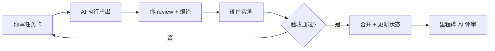

# 人机分工框架

> 目的：让 AI 加速，但不替人"拥有"项目。
> 判断标准：合上代码，能否脱稿讲清设计取舍、时序和 bug 定位。

## 1. 角色

| 角色 | 占比 | 职责 | 不做什么 |
|---|---|---|---|
| 你（Owner） | 50% | 冻结约定、核心红区、硬件联调、最终 review、面试讲解 | 不把核心模块整体外包 |
| AI 架构评审 | 15% | 任务拆解、接口评审、里程碑复盘、风险清单 | 不代写实现、不直接改代码 |
| AI 执行助手 | 35% | HAL 脚手架、生成器、测试脚本、文档初稿 | 不改冻结约定、不碰红区 |

AI 可以换模型，角色不变：**一个负责挑毛病，一个负责干重复活**。

## 2. RACI：每个模块谁负责

R=负责执行，A=最终拍板，C=被咨询，I=知会。

| 模块 | 你 | AI 执行 | AI 评审 |
|---|---|---|---|
| 寄存器表 CSV | A | R（初版） | C |
| 寄存器表生成器 | A | R | C |
| F103 UART/DMA/IDLE | **A/R** | C（脚手架） | C |
| DE/RE 时序 | **A/R** | I | C |
| 从站协议接入 | **A/R** | C | C |
| 4 从站路由/广播 | **A/R** | C | C |
| 故障注入 | A | R | C |
| 主站事务状态机 | **A/R** | I | C |
| 多从站调度 | **A/R** | I | C |
| 寄存器镜像 | **A/R** | C | C |
| FreeRTOS 任务/队列 | **A/R** | C | C |
| Linux epoll/SQLite | A | R | C |
| Python 测试工具 | A | R | C |
| 测试报告/README | A | R（初稿） | C |

**红区（必须你写、必须能解释）**：

1. RS485 DE/RE 时序；
2. 非阻塞事务状态机；
3. 多从站调度；
4. 寄存器镜像与有效期；
5. 协议拆包与异常判定。

AI 可以 review、补测试、解释，但不能替你把这几块"讲过去"。

## 3. AI 可以做 / 不可以做

### 可以做

- 生成 HAL 初始化脚手架、寄存器表生成器、CRC 测试向量；
- 写 Python 模拟器/测试脚本/日志分析；
- 写文档初稿、任务卡拆解、代码 review 清单；
- 根据错误日志给出排查假设，由你验证。

### 不可以做

- 修改 `docs/register-map.csv` 的冻结约定（地址、空间、权限）；
- 直接把未验证代码推到 `main`；
- 编造实测数字、测试结果、波形；
- 替写红区核心并声称"已完成"；
- 把 AI 交接内容、个人联系方式、内部策略放进展示仓库。

## 4. 任务卡

```text
任务编号：W1-T3
目标：一句话说明要解决什么问题
输入：相关文档、现有代码、硬件条件
产出：具体文件/接口
验收：可运行的检查或实测标准
禁止：不许改的冻结项、不许引入的依赖
负责：你 / AI 执行 / AI 评审
```

任务卡必须能独立验收。需要"顺便改另一个模块"时，拆成两张。

## 5. 工作流程



规则：

1. 一次只做一个任务卡；
2. AI 只能改任务卡"产出"里列的文件；
3. AI 代码必须过编译 + 测试 + 你 review；
4. 硬件数据必须你测；
5. 里程碑结束评审一次，不逐行问。

## 6. 给 AI 的上下文包

每次只给：

- `docs/AI-HANDOFF.md`（冻结约定）
- `docs/project-framework.md`（总体框架）
- `docs/development-framework.md`（开发流程）
- 当前任务卡
- 相关源文件路径

不要一次贴整个仓库；不要让 AI 自行搜索并修改未列出的文件。

## 7. 每周自检

- 合上代码，脱稿讲 5 分钟：架构、为什么这么分层、一个 bug 怎么定位。
- 讲不清的模块，下周自己重写一遍。
- 简历数字必须来自实测记录，不允许 AI 生成。
- 每周记录：完成了哪张任务卡、卡在哪、下周做什么。

## 8. 展示仓库规则

- 只放：经过验证的代码、README、架构/协议/寄存器/测试文档。
- 不放：AI 交接、任务卡、人机分工、个人求职策略、未验证代码。
- 展示仓库的文档要工整：一张图、一张表、一段结论，不贴聊天记录。
