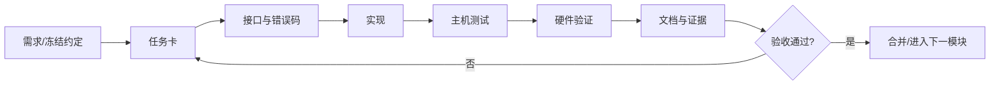

# 开发框架

> 这份文档回答：一个模块从想法到验收，按什么顺序做、每步交什么、什么算做完。
> 目标是把"写代码"变成可重复的工程流程，而不是想到哪写到哪。

## 1. 五条原则

1. **一次只做一个模块**：不同时改从站、主站和 Linux。
2. **接口先行**：先定头文件、错误码、状态机，再写实现。
3. **模拟先行**：没有硬件时先用 Python 模拟器把协议跑通。
4. **实测为准**：所有性能/稳定性数字必须来自日志或仪器，不写设计目标当结果。
5. **单一事实源**：寄存器表只改 CSV，协议约定只改冻结文档，其他位置由生成器同步。

## 2. 开发流程



每一步的产物：

| 步骤 | 产物 | 检查 |
|---|---|---|
| 需求 | 一页说明、边界、非目标 | 是否和冻结约定冲突 |
| 任务卡 | 目标/输入/产出/验收/禁止 | 是否能独立验收 |
| 接口 | 头文件、错误码、状态机 | 调用方是否能不看实现就使用 |
| 实现 | 源文件 | 是否无动态内存、无阻塞延时 |
| 主机测试 | 测试脚本/向量 | 是否能重复运行 |
| 硬件验证 | 波形/日志/读回 | 是否有可复现命令 |
| 文档 | README/测试报告 | 数字是否来自实测 |

## 3. 任务卡模板

```text
任务编号：W1-T3
目标：一句话说明要解决什么问题
输入：相关文档、现有代码、硬件条件
产出：具体文件/接口
验收：可运行的检查或实测标准
禁止：不许改的冻结项、不许引入的依赖
风险：可能卡住的地方与降级方案
```

任务卡必须能独立验收。如果一条任务卡需要"顺便改另一个模块"，拆成两条。

## 4. 分支与提交

- 分支：`feature/w1-t3-rs485-port`、`fix/w2-timeout-retry`、`docs/...`
- 提交信息：
  - `feat: ...` 新功能
  - `fix: ...` 修复
  - `test: ...` 测试
  - `docs: ...` 文档
- 一个任务卡一个分支；合并前必须过验收。
- 不直接推 `main`；展示仓库只放验证过的干净内容。

## 5. 质量门禁

### 5.1 代码

- C99；无动态内存；固定缓冲区。
- 中断共享变量 `volatile`；临界区保护。
- FreeRTOS 任务中禁止 `HAL_Delay()`；裸机主循环用 SysTick 非阻塞。
- 错误码统一枚举；不返回裸 `-1`。
- 协议/CRC 必须有测试向量。

### 5.2 测试

- 主机测试可重复运行，失败能定位到具体断言。
- 硬件测试记录：命令、接线、波形、日志、结果。
- 故障注入至少覆盖：CRC 错、超时、非法地址、非法功能码、断线。
- 稳定性先 2–4h soak，24h 作为冲刺目标。

### 5.3 时序

- RS485：DE 拉高 → 发送 → 等 UART TC → 拉低 DE。
- 帧间至少 3.5 字符静默；主站事务之间留总线周转。
- 逻辑分析仪截图或波形描述进测试报告。

## 6. 里程碑评审

| 阶段 | 评审问题 | 不通过怎么办 |
|---|---|---|
| W1 | 1000 次读是否无错？异常码是否正确？ | 先修从站，不进入主站 |
| W2 | 拔线是否超时？恢复是否重试？ | 先修状态机，不进入 RTOS |
| W3 | 通信时其他任务是否正常？栈/队列是否可解释？ | 先测栈余量，不进入调度 |
| W4 | 单从站掉线是否影响其他？能否演示？ | 不写简历，继续修 |
| W5 | 半包/粘包/断线是否处理？ | 先修拆包，不接 LwIP |
| W6 | 2–4h soak 是否通过？ | 降级为"MCU MVP + 可选服务" |

## 7. 评审清单

- [ ] 是否违反冻结约定（波特率、从站数、寄存器空间、协议头）？
- [ ] 是否有未定义行为（越界、空指针、未初始化）？
- [ ] 是否在中断里做耗时操作？
- [ ] 是否有阻塞延时？
- [ ] 错误路径是否计数并可观测？
- [ ] 测试是否覆盖正常/异常/边界？
- [ ] 文档数字是否来自实测？
- [ ] 是否能把设计取舍讲清 5 分钟？

## 8. 证据与报告

每个里程碑保留：

- 测试命令与版本（commit SHA）；
- 原始日志/CSV；
- 波形截图或仪器设置；
- 失败复现步骤；
- 结论与已知限制。

报告只写"做了什么、测了什么、结果是什么、没测什么"，不写"预计""大概"。

## 9. 变更管理

冻结项（v1）：

- RS485 115200 8N1；
- 4 个逻辑从站；
- 0x03/0x04 空间划分；
- 26 字节应用层头；
- CRC16 两种多项式分开。

改冻结项必须：

1. 写变更原因与影响；
2. 同步 F103/F407/Python/Linux 四处；
3. 更新 `register-map.csv` 并重新生成；
4. 重跑相关测试。

## 10. 风险与降级

| 风险 | 降级 |
|---|---|
| 115200 判帧不稳 | 先降 19200 + 500ms 周期，跑通再升 |
| F103 硬件未到 | Python 从站模拟器先给主站供数 |
| LwIP/PHY 调不通 | 跳过 W6，保留 MCU MVP |
| 时间不足 | 保 W1–W4，Linux 作为可选加分 |
