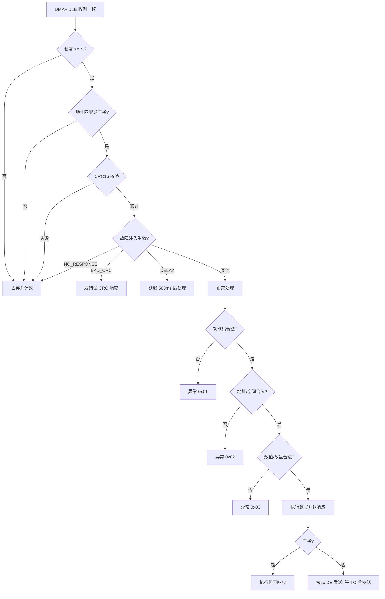

# 开发总纲：分层框架、模块契约与任务拆解

> 用途：解决"大型项目不知道从何下手"。先看分层，再看模块契约，最后按任务卡顺序做。
> 规则：一次只做一个任务卡；先接口后实现；先模拟后硬件；先 MVP 后扩展。
> 配套：`project-framework.md`（系统组成）、`development-framework.md`（流程与门禁）、`learning-framework.md`（学习地图）。
> 本文档不替代 `AI-HANDOFF.md`（冻结约定），只负责把约定拆成可执行的工程结构。

---

## 1. 一句话与 MVP 边界

**MVP（W1–W4，简历只依赖这部分）**：
F103 从站 + RS485 + F407 FreeRTOS 主站/调度/镜像 + Python 测试工具。

**可选扩展（W5–W6，不阻塞 MVP）**：
LwIP + Linux C（epoll + SQLite）+ 24h 稳定性。

判断标准：W4 结束没有可演示的 MCU MVP，就不替换简历第三项目。

---

## 2. 分层框架（自底向上）

| 层 | 名字 | 内容 | 谁负责 |
|---|---|---|---|
| L0 | 硬件层 | F103、F407、SP3485/MAX3485、USB-RS485、120Ω 终端、共地 | 你 |
| L1 | 驱动层 | UART + DMA + IDLE、DE/RE GPIO、SysTick、调试串口 | 你写时序，DeepSeek 写脚手架 |
| L2 | 协议层 | **复用开源协议栈**（见 `third-party.md`）：0x03/0x04/0x06/0x10、异常码、广播 | 库 + 你做适配 |
| L3 | 事务层（F407） | 非阻塞状态机、超时、重试、总线周转 | 你 |
| L4 | 调度层（F407） | 4 从站周期、离线降频、恢复上线、写优先、队列 | 你 |
| L5 | 镜像层（F407） | RegisterEntry、有效期、32 位原子更新、权限 | 你 |
| L6 | 工具层（PC） | Python 主站/从站模拟、故障注入、日志分析、报告 | DeepSeek |
| L7 | 网络层（可选） | LwIP、26 字节协议头、Linux epoll/SQLite | 二期再定 |

**关键原则**：L2 以下不依赖 L3 以上；F103 只用 L0–L2 + L6；F407 用 L0–L5 + L6；L7 不许反向影响 L1–L5 的接口。

**复用边界**：L2 的协议编解码、CRC、功能码分发用成熟开源库，不从零写；L1/L3/L4/L5 和故障注入自己写，这才是项目深度所在。选型见 `docs/third-party.md`。

---

## 3. 目录与模块契约

```text
modbus/
├── docs/
├── shared/registers/         # 由 docs/register-map.csv 生成，F103/F407 共用
├── device-f103/
│   └── App/
│       ├── modbus_slave/     # 协议栈适配、异常响应
│       ├── register_map/     # 寄存器空间与权限
│       ├── fault_injection/  # 故障注入与 30s 自恢复
│       └── port/             # UART/DMA/IDLE、DE/RE、SysTick
├── gateway-f407/
│   └── App/
│       ├── modbus/           # 主站事务状态机、传输
│       ├── scheduler/        # 周期调度、离线/恢复
│       ├── register_model/   # 镜像、有效期、原子更新
│       └── health_monitor/   # 任务心跳、栈余量、喂狗
├── third_party/nanomodbus/   # MIT，协议栈
├── tests/host/               # CRC/工具的主机测试
└── tools/
    ├── register_map/         # CSV -> C/Python 生成器
    ├── modbus_master_tester/ # W1 验收主站（pymodbus）
    ├── modbus_simulator/     # 从站模拟
    ├── fault_injector/       # 故障注入
    └── test_reports/         # 报告生成
```

### 3.1 接口先行（只定签名，不写实现）

以下是你这边的**适配层/业务层接口**，协议栈内部实现交给开源库；不要照这些接口从零写一套 Modbus。

```c
/* CRC16：Modbus，多项式 0xA001，初值 0xFFFF，低字节在前 */
uint16_t mb_crc16(const uint8_t *data, uint16_t len);
/* 测试向量："123456789" -> 0x4B37 */

/* F103 从站：输入一帧，输出响应或异常 */
MbError mb_slave_handle_frame(MbSlaveCtx *ctx,
                              const uint8_t *frame, uint16_t len,
                              uint8_t *resp, uint16_t *resp_len);

/* 寄存器空间：0x03 与 0x04 独立，地址 0-based */
MbError mb_regs_read (uint8_t slave, MbSpace space,
                      uint16_t addr, uint16_t qty, uint16_t *out);
MbError mb_regs_write(uint8_t slave, uint16_t addr,
                      const uint16_t *values, uint16_t qty);

/* 故障注入：只影响本从站，NO_RESPONSE 30s 自恢复 */
void fault_set (uint8_t slave, FaultMode mode);
void fault_tick(uint32_t now_ms);

/* F407 传输：一次只允许一个事务，禁止阻塞等待 */
MbError mb_transport_start (ModbusTransaction *t);
void    mb_transport_tick  (uint32_t now_ms);
void    mb_transport_on_rx (const uint8_t *frame, uint16_t len);

/* F407 调度与镜像 */
void scheduler_tick(uint32_t now_ms);
void rm_update(uint8_t slave, MbSpace space, uint16_t addr,
               const uint16_t *values, uint16_t qty, uint32_t ts);
bool rm_read(PointId point, RegisterEntry *out);
```

### 3.2 错误码（模块错误码 ≠ Modbus 异常码）

| 模块错误码 | 含义 | 对应 Modbus 异常 |
|---|---|---|
| MB_OK | 成功 | — |
| MB_ERR_NOT_FOR_ME | 非本从站地址 | 不响应 |
| MB_ERR_CRC | CRC 失败 | 丢弃并计数 |
| MB_ERR_FUNC | 不支持的功能码 | 0x01 |
| MB_ERR_ADDR | 非法地址/空间 | 0x02 |
| MB_ERR_VALUE | 非法数值/数量 | 0x03 |
| MB_ERR_DEVICE | 从站故障 | 0x04 |
| MB_ERR_TIMEOUT | 主站等待超时 | 主站内部 |
| MB_ERR_BUSY | 总线被占用 | 主站内部 |

**判定规则**：从站返回异常响应说明它"活着"，不计入通信失败；只有超时、CRC 错、帧错误才算通信失败。

---

## 4. 状态机（先画清楚再写代码）

### 4.1 F103 帧解析流程



### 4.2 F407 事务状态机（W2 预览）

`IDLE → BUILDING → TRANSMITTING → WAIT_TX_COMPLETE → TURNAROUND → WAIT_RESPONSE → VALIDATING → COMPLETED / RETRY / FAILED`

新增 `TURNAROUND`：保证两次事务之间有 3.5 字符静默；RETRY 不原地阻塞，放回队列尾部。

---

## 5. W1 任务卡（按顺序做，做完一张勾一张）

| # | 任务 | 产出文件 | 负责 | 验收 | 状态 |
|---|---|---|---|---|---|
| T0 | 选型与引入第三方库 | `third_party/nanomodbus/` + LICENSE + 来源说明 | 你定方案，DeepSeek 整理 | 能编译官方示例，许可文件齐全 | 完成 |
| T1 | 寄存器表单一来源 | `docs/register-map.csv` + 生成器 + `shared/registers/` | DeepSeek 初版，你审核 | 改一处 CSV，四处同步更新 | 完成 |
| T2 | CRC16 复用验证 | `tests/host/test_crc16.py` | DeepSeek 写测试，你验证 | 标准值 0x4B37，nanoMODBUS 线上等价 | 完成 |
| T3 | UART/DMA/IDLE + DE/RE | `device-f103/App/port/rs485_port.c/.h` | 你写时序，DeepSeek 写初始化 | 逻辑分析仪看到完整帧，DE 在 TC 后释放 | 待硬件确认 |
| T4 | 协议栈接入与异常/广播策略 | `device-f103/App/modbus_slave/mb_slave.c/.h` + `mb_router.c/.h` | 你 | 非法地址返回 0x02，CRC 错丢弃，广播不响应 | 代码完成，待编译/硬件 |
| T5 | 寄存器空间与权限 | `device-f103/App/register_map/mb_regs.c` | DeepSeek 骨架，你写规则 | 0x03/0x04 不串空间，越界返回异常 | 代码完成，待编译 |
| T6 | 故障注入 | `device-f103/App/fault_injection/fault_injection.c` | DeepSeek | NO_RESPONSE 30s 自恢复，不影响其他从站 | 代码完成，待编译/硬件 |
| T7 | PC 主站测试脚本（基于 pymodbus） | `tools/modbus_master_tester/` | DeepSeek | 连续读 N 次、异常码检查、写回显 | 基础版完成，TCP 回环通过 |
| T8 | 联调验收 | 测试报告 + 演示 | 你 | 0x03/0x04 各 1000 次无错；0x06/0x10 回显正确 | 待硬件 |

**W1 禁止**：FreeRTOS、LwIP、Linux、SQLite、双区配置。

> CRC 约定：标准 Modbus CRC16 数值为 `0x4B37`（`"123456789"`）。nanoMODBUS 的 `nmbs_crc_calc` 返回按线上顺序交换过的 `0x374B`，用 `put_2` 高字节先写即为 `37 4B`，与标准值低字节先发等价。测试脚本同时校验这两个值。

---

## 6. W2–W4 里程碑（先知道方向，不展开）

| 周 | 目标 | 验收 |
|---|---|---|
| W2 | F407 主站 + 超时/重试 | 单从站读写正常，拔线超时，DE/RE 时序正确 |
| W3 | FreeRTOS 状态机 + 队列 | 通信期间其他任务正常运行，栈/队列占用可解释 |
| W4 | 4 从站调度 + 镜像 + 离线/恢复 | 关一个从站不影响其他；形成可演示 MCU MVP |

W4 结束：补 README 实测数据 + 2 分钟演示，再决定是否替换简历第三项目。

---

## 7. 开工前必须确认的硬件信息

1. F103 具体型号（是否 C8T6，Flash/RAM 大小）。
2. RS485 用哪个 UART，TX/RX 引脚是什么。
3. DE/RE 接哪个 GPIO，模块是否自动收发。
4. F103 侧模块是否 3.3V 逻辑。
5. 调试串口用哪个 UART（用于清除故障注入）。
6. USB-RS485 与板子是否共地，A/B 是否双绞。

**不确定就先问，不要猜。**

---

## 8. 降级路径

- 115200 判帧不稳 → 临时降 19200 + 500ms 周期，先跑通再升回来。
- F103 硬件没到位 → 先用 Python 从站模拟器开发 PC 主站测试脚本。
- F407/LwIP 卡住 → 不影响 W1–W4，直接跳过二期。
