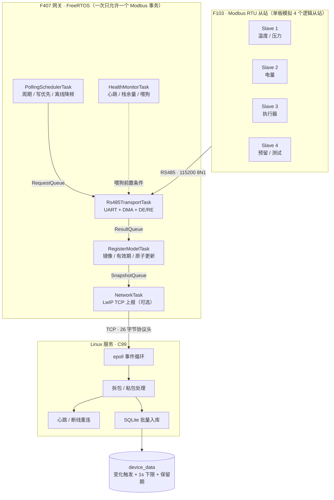
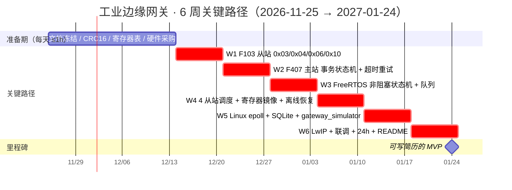

# 总览图：全链路数据流与 6 周排期

> 用途：一屏看清数据怎么走、时间怎么排。GitHub 直接渲染 Mermaid。
> 约定以 `AI-HANDOFF.md`（冻结 v1）为准，本文件只做可视化，不引入新约定。

---

## 1. 全链路数据流

要点：

- 同一时刻只有 `Rs485TransportTask` 碰 UART/RS485，其他任务通过队列交互。
- 测量值走 0x04、参数/控制走 0x03，地址一律 0-based。
- 只有所有关键任务心跳都在有效期内，`HealthMonitorTask` 才喂狗。

---

## 2. 6 周排期（关键路径）

节奏：12/12 CET-4 之前每天最多 1 小时（只做文档/CRC16/寄存器表）；12/13 起每天 2–3 小时。任何一周延期都会推迟 1/24 的 MVP 节点。

| 周 | 交付物 | 验收 |
|---|---|---|
| W1 | F103 从站 4 个功能码 + CRC16 + RS485 + 故障注入 | 0x03/0x04 各连续读 1000 次无错；写回显正确；非法地址返回 0x02 |
| W2 | F407 主站 0x03/0x04/0x06/0x10 + 超时/重试 | 单从站读写正常；拔线超时、重试计数正确 |
| W3 | FreeRTOS 非阻塞状态机 + 队列 | 通信期间其他任务正常运行 |
| W4 | 4 从站调度 + 寄存器镜像 + 离线/恢复 | 关闭一个从站不影响其他；形成 MCU MVP |
| W5 | Linux C epoll + SQLite + gateway_simulator | 模拟多网关，数据按策略入库 |
| W6 | LwIP + 联调 + 故障注入 + 24h + README | 20 个场景 + 演示视频 |

> 完整验收标准与寄存器表见 `AI-HANDOFF.md`；W1 提前做全 4 个功能码，是为了避免 W2 主站测试 0x04/0x10 时从站不支持而返工。
