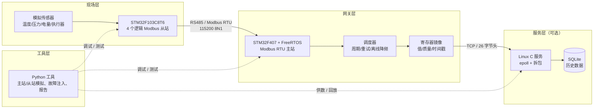

# 项目总体框架

> 这份文档回答三个问题：项目由什么组成、每部分负责什么、先做哪一块。
> 读完后应该能画出系统框图，并说清一条数据从传感器到数据库经过哪些环节。

## 1. 项目一句话

**现场设备（Modbus RTU 从站）→ RS485 → 网关（Modbus RTU 主站 + FreeRTOS）→ 以太网 → Linux 服务（epoll + SQLite）**。

目标不是"能通信"，而是**多设备、可恢复、可验证**：单台设备掉线不影响其他设备，异常能定位，数据能落库，测试结果可复现。

## 2. 系统组成



四条边界要分清：

1. **现场层**只负责"我是一个从站"，不关心网关怎么调度。
2. **网关层**负责"把多个从站的数据变成统一镜像"，不关心 Linux 怎么存。
3. **服务层**负责"连接、拆包、入库"，不反向依赖 MCU 的内部结构。
4. **工具层**是开发与验收的脚手架，不参与量产业务。

## 3. 模块职责

### 3.1 F103 从站

| 模块 | 职责 | 不做什么 |
|---|---|---|
| `port/rs485_port` | UART DMA + IDLE 判帧、DE/RE 时序、错误计数 | 不解析功能码 |
| `modbus_slave/mb_slave` | 接协议栈、异常码映射、故障注入 | 不实现业务寄存器 |
| `modbus_slave/mb_router` | 按从站地址分发、广播写、轮询 4 个 server | 不做调度 |
| `register_map/mb_regs` | 0x03/0x04 空间、权限、u32、清零命令 | 不处理串口 |
| `fault_injection` | 6 种故障模式，NO_RESPONSE 30s 自恢复 | 不影响其他从站 |
| `app_f103` | 初始化、主循环、模拟传感器 | 不放协议细节 |

### 3.2 F407 网关

| 模块 | 职责 |
|---|---|
| `modbus` | 主站事务状态机、超时、重试、总线周转 |
| `scheduler` | 4 从站周期、写优先、离线降频、恢复上线 |
| `register_model` | 点位镜像、有效期、32 位原子更新 |
| `health_monitor` | 任务心跳、栈余量、队列占用、喂狗 |
| `network`（可选） | LwIP/TCP 上报，不阻塞采集 |

### 3.3 Linux 服务（可选）

- epoll 事件循环、非阻塞 socket；
- 半包/粘包、帧头 CRC、payload CRC；
- SQLite 批量写入、WAL、保留期清理；
- 断线重连、心跳超时。

### 3.4 Python 工具

- 主站测试：连续读、写回显、异常码、延迟统计；
- 从站模拟：无硬件时给网关供数；
- 故障注入：CRC 错、超时、截断、断线；
- 报告：成功率、P50/P95、故障次数、数据库行数。

## 4. 两条数据链路

### 4.1 采集上行

```text
F103 传感器 → 输入寄存器 → RS485 请求 → F407 事务状态机
→ 寄存器镜像（值/质量/时间戳）→ 可选 TCP 上报 → Linux 拆包 → SQLite
```

关键点：

- 测量值走 **0x04 输入寄存器**，参数/控制走 **0x03 保持寄存器**；
- 地址 0-based；u32 统一 ABCD；
- 镜像按"逻辑点"更新，32 位值一次性写入，避免半新半旧；
- 每个点带 `valid`、`timestamp`、`quality`。

### 4.2 控制下行

```text
Linux/PC → 写请求 → F407 写队列（优先于采集）
→ Modbus 0x06/0x10 → F103 执行 → 回读状态确认
```

关键点：

- 写请求优先，但要防止饿死采集；
- 从站返回异常响应 ≠ 通信失败，不能因此判离线；
- 写成功以回读为准，不以请求发出为准。

## 5. 目录结构

```text
├── docs/                 设计与过程文档
├── shared/registers/     寄存器表生成物（F103/F407 共用）
├── device-f103/          从站固件
├── gateway-f407/         网关固件
├── linux-server/         Linux 服务（可选）
├── third_party/          第三方库与许可证
├── tests/host/           主机测试
└── tools/                Python 工具与生成器
```

## 6. 里程碑

| 阶段 | 目标 | 交付物 | 门禁 |
|---|---|---|---|
| W1 | F103 从站 0x03/0x04/0x06/0x10 + 故障注入 | 从站固件、PC 主站脚本、测试记录 | 1000 次读无错，异常码正确 |
| W2 | F407 主站 + 超时/重试 | 主站状态机、单从站读写 | 拔线超时，恢复后重试成功 |
| W3 | FreeRTOS 任务/队列 | 任务划分、栈/队列统计 | 通信时其他任务不阻塞 |
| W4 | 4 从站调度 + 镜像 | 可演示 MCU MVP | 单从站掉线不影响其他 |
| W5 | Linux epoll + SQLite | 服务、模拟器、入库报告 | 半包/粘包、断线重连 |
| W6 | LwIP + 联调 + 稳定性 | 联调报告、演示 | 2–4h soak，24h 为冲刺 |

**W4 是硬门槛**：没有可演示的 MCU MVP，不把项目写成"已完成"。

## 7. 质量属性

- **可靠性**：超时、重试、离线降频、恢复上线、看门狗分级喂狗。
- **可测试性**：PC 模拟器、故障注入、固定测试向量、可复现命令。
- **可观测性**：错误计数、队列占用、栈余量、延迟分位数。
- **可移植性**：协议核心不依赖 HAL；驱动层通过 `rs485_port` 隔离。

## 8. 非目标

- 不做 GUI/仪表盘、云端集群、AUTOSAR、DoIP；
- 不追求一次做完 Linux/LwIP；
- 不把设计目标写成实测结果。

## 9. 文档索引

- `development-framework.md`：任务卡、分支、测试与门禁
- `architecture.md`：系统架构与任务模型
- `protocol.md`：Modbus RTU 与应用层协议
- `register-map.md` / `register-map.csv`：寄存器表
- `test-plan.md`：测试矩阵与稳定性计划

> 工作仓库与展示仓库的文档集合略有差异；以各仓库实际文件为准。
